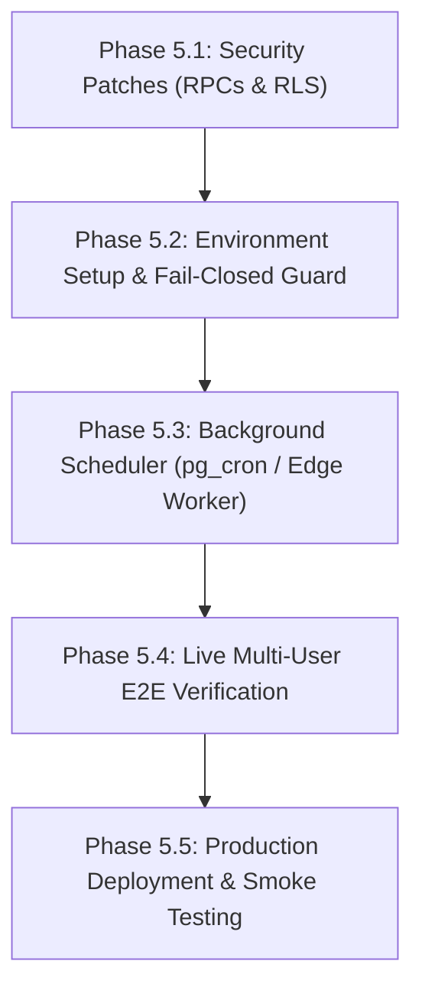

# TimeSwap — Phase 5: Production Readiness Audit Report (Read-Only)

**Date**: October 20, 2026  
**Auditor**: Senior Backend Architect, Application Security Auditor & QA Engineer  
**Scope**: Full repository inspection of TimeSwap (Next.js 14 App Router, Supabase/PostgreSQL schema, RLS policies, RPCs, Auth, Realtime, Tests, Environment Configuration).  
**Mode**: Read-Only Analysis (No modifications made).

---

## 1. Environment & Architecture Summary

### 1.1 Current Environment Classification: **Mixed / Local Standalone PostgreSQL**
- **Evidence**:
  1. **Database Container**: Docker container `timeswap-postgres` (`postgres:16-alpine`) is running on port `5432`.
  2. **Supabase Local Stack**: Ports `54321` (API Gateway / Kong), `54322` (DB), and `54329` (Pooler) are **not open**. Neither Supabase CLI nor GoTrue / PostgREST / Realtime daemons are running locally.
  3. **Hosted Supabase**: No connection to hosted Supabase is active. No `.env` or `.env.local` file exists in the repository root (only `.env.example`).
  4. **Test Architecture**: Test suites (`tests/test-db-phase1.mjs`, `test-phase2.mjs`, `test-phase3.mjs`, `test-phase4.mjs`) connect directly to port `5432` via the Node `pg` client and create a simulated `auth` schema (`auth.users`, mock `auth.uid()`) rather than executing against a live Supabase PostgREST or GoTrue service.

### 1.2 Environment Variable Configuration Status

| Environment Variable | Status in Environment | Required For |
| :--- | :--- | :--- |
| `NEXT_PUBLIC_SUPABASE_URL` | **MISSING** | Browser & Server Supabase client initialization |
| `NEXT_PUBLIC_SUPABASE_ANON_KEY` | **MISSING** | Public client RLS-scoped database/auth requests |
| `SUPABASE_SERVICE_ROLE_KEY` | **MISSING** | Admin background worker & service role client |
| `DATABASE_URL` | **MISSING** | Direct database connection / migration runners |
| `NEXT_PUBLIC_APP_URL` | **MISSING** (Defaults to `http://localhost:3000`) | Auth callback URL redirection |
| `PGHOST`, `PGPORT`, `PGUSER`, `PGPASSWORD`, `PGDATABASE` | **MISSING** (Tests default to local container) | Test runner connectivity |

### 1.3 Architecture & Data Flow
- **Frontend-to-Backend Flow**: The Next.js frontend uses `@supabase/ssr` via `getSupabaseBrowserClient()`. Database logic is implemented as PostgreSQL stored procedures (`SECURITY DEFINER` RPCs).
- **The "Silent Fallback" Risk**:
  In `src/lib/store.tsx`, if `getSupabaseBrowserClient()` returns `null` (because `NEXT_PUBLIC_SUPABASE_URL` is missing) or if `authUserId` is `null`, every critical operation (`requestSession`, `acceptSession`, `declineSession`, `cancelSession`, `confirmCompletion`, `sendMessage`) **silently falls back to client-side in-memory and `localStorage` mutations**.
  > [!CAUTION]
  > **Fail-Open Mock Risk**: In a production deployment where environment variables are misconfigured or Supabase connectivity drops, the application does not fail closed with an error. Instead, it presents an apparently functional UI persisting fake sessions and credits to browser `localStorage`.

---

## 2. Security Findings

Findings are classified by severity according to standard application security guidelines:

### Critical & High Severity Findings

#### SEC-01 [HIGH] — Unauthorized Session Expiry via `expire_session_request`
- **Location**: `supabase/migrations/20261020000005_phase3_session_booking_and_escrow.sql#L330-L393`
- **Vulnerability**: 
  1. `expire_session_request(p_session_id UUID)` is declared `SECURITY DEFINER` and granted to `authenticated` role (`GRANT EXECUTE ON FUNCTION public.expire_session_request TO authenticated;`).
  2. The function **never verifies caller identity** (`auth.uid()`).
  3. The function **never checks whether the expiry deadline has passed** (`now() >= scheduled_start_at - 2 hours` or `created_at + 48 hours`). It only verifies `v_session.status = 'requested'`.
- **Impact**: Any authenticated user (including malicious third party Carol) can invoke `supabase.rpc('expire_session_request', { p_session_id: alice_session_id })` on any pending session immediately after booking, arbitrarily aborting requests and forcing escrow refunds.
- **Remediation**: Either restrict execution to `service_role` (for background sweeps), or strictly require `(auth.uid() = v_session.learner_id OR auth.uid() = v_session.teacher_id)` AND verify that the expiration threshold has actually passed before allowing status transition.

#### SEC-02 [HIGH] — Client-Controlled Availability Parameter in Late Cancellation
- **Location**: `supabase/migrations/20261020000005_phase3_session_booking_and_escrow.sql#L404-L525`
- **Vulnerability**:
  In `cancel_session(p_session_id, p_reason, p_mentor_was_available)`:
  ```sql
  IF p_mentor_was_available IS NOT NULL THEN
      v_mentor_available := p_mentor_was_available;
  ELSE ...
  ```
  When a learner cancels late (`<= 2 hours` before start), passing `p_mentor_was_available := false` overrides the database calendar check.
- **Impact**: A cancelling learner can pass `false` to deny the available mentor their guaranteed 1-credit late cancellation compensation, diverting the session to `under_review` instead of paying the mentor.
- **Remediation**: Remove client-supplied `p_mentor_was_available`. The determination of mentor availability must be 100% server-authoritative based on accepted session state and `public.availability_slots`.

#### SEC-03 [HIGH] — Unrestricted Profile Reputation Column Updates in RLS
- **Location**: `supabase/migrations/20261020000002_rls_policies.sql#L37-L41`
- **Vulnerability**:
  `CREATE POLICY "profiles_update_own" ON public.profiles FOR UPDATE USING (auth.uid() = id) WITH CHECK (auth.uid() = id);` applies to all columns in `public.profiles`.
- **Impact**: An authenticated user can send `PATCH /rest/v1/profiles?id=eq.<uid>` containing `{"hours_taught": 500, "rating": 5.00, "review_count": 100}` and forge their platform reputation directly through PostgREST.
- **Remediation**: Revoke generic update permissions on `public.profiles` for `authenticated` and grant column-level update only on user-editable fields (`name`, `headline`, `bio`, `location`, `timezone`, `avatar_url`, `skills_learning`, `notification_preferences`, `onboarding_step`, `onboarding_completed`), or add a `BEFORE UPDATE` trigger raising an exception if `hours_taught`, `hours_learned`, `rating`, or `review_count` are altered outside trusted completion RPCs.

---

### Medium Severity Findings

#### SEC-04 [MEDIUM] — Administrative / Batch Workers Granted to `authenticated` Role
- **Location**: `supabase/migrations/20261020000005_phase3_session_booking_and_escrow.sql#L855-L856`
- **Vulnerability**: `flag_unresolved_sessions` and `expire_pending_requests` are granted to `authenticated`.
- **Impact**: Any normal logged-in user can trigger full table batch loops and row locks (`FOR UPDATE OF s`) over the network, posing a Denial-of-Service (DoS) and concurrency lock contention risk.
- **Remediation**: `REVOKE EXECUTE ON FUNCTION public.flag_unresolved_sessions FROM authenticated;` and `REVOKE EXECUTE ON FUNCTION public.expire_pending_requests FROM authenticated;`. Reserve them strictly for `service_role` or database-internal schedulers (`pg_cron`).

#### SEC-05 [MEDIUM] — Missing Automated Scheduler for Expiry & 72-Hour Unresolved Flagging
- **Location**: Repository-wide
- **Finding**: While the logic in `flag_unresolved_sessions()` and `expire_pending_requests()` is implemented, there is **no cron scheduler, edge function, or `pg_cron` extension call** configured anywhere in the project.
- **Impact**: In production, pending sessions will never expire and 72-hour sessions will never transition to `under_review` unless an external operator manually runs the SQL commands.
- **Remediation**: Create a Supabase Edge Function or `pg_cron` schedule that invokes these batch routines every 15–60 minutes using service-role credentials.

#### SEC-06 [MEDIUM] — Handle Collision Crashes Registration Trigger
- **Location**: `supabase/migrations/20261020000003_auth_trigger_welcome_credits.sql#L48-L62`
- **Vulnerability**:
  In `fn_handle_user_verification_and_welcome_grant()`:
  `INSERT INTO public.profiles (id, handle, ...) VALUES (NEW.id, v_handle, ...) ON CONFLICT (id) DO NOTHING;`
  The conflict target is `(id)`. If another user already registered with the requested `handle`, the query crashes with `duplicate key value violates unique constraint "profiles_handle_key"`.
- **Impact**: Because this runs `AFTER INSERT OR UPDATE ON auth.users`, any handle collision completely aborts user signup or email verification.
- **Remediation**: Handle handle collisions gracefully by appending random alphanumeric suffixes (e.g. `v_handle := v_handle || '_' || substr(gen_random_uuid()::text, 1, 4)`) in a collision loop before insertion.

#### SEC-07 [MEDIUM] — Missing Calendar Conflict / Timeslot Overlap Constraints
- **Location**: `supabase/migrations/20261020000005_phase3_session_booking_and_escrow.sql#L36-L120`
- **Finding**: `create_session_request` does not check whether the mentor already has an overlapping `accepted` or `requested` session during `[scheduled_start_at, scheduled_end_at]`.
- **Impact**: A mentor can be booked for multiple conflicting sessions at the exact same hour.

---

### Low & Informational Findings

#### SEC-08 [LOW] — Incomplete Profiles Visible via Direct PostgREST Query
- **Location**: `supabase/migrations/20261020000002_rls_policies.sql#L27-L30`
- **Finding**: `profiles_select_public` allows `SELECT USING (true)`. Incomplete profiles (`onboarding_completed = false`) are filtered only by the frontend UI query, not by Row Level Security.
- **Impact**: Any direct API query to `/rest/v1/profiles` exposes users who have not completed onboarding.

#### SEC-09 [LOW] — Potential Deadlock in Concurrent Reverse-Pair Settlements
- **Location**: `supabase/migrations/20261020000005_phase3_session_booking_and_escrow.sql#L693-L701`
- **Finding**: `confirm_session_completion` always updates the learner's wallet first, then the teacher's wallet. If Alice teaches Bob in session 1, and Bob teaches Alice in session 2, concurrent bilateral confirmations at the exact same microsecond could deadlock on wallet row locks.
- **Remediation**: Always acquire wallet locks in deterministic order (e.g., `ORDER BY profile_id` or `LEAST/GREATEST`).

#### SEC-10 [INFORMATIONAL] — Lack of Dispute Resolution Tooling for `under_review`
- **Location**: `supabase/migrations/20261020000001_initial_schema.sql#L258`
- **Finding**: While `admin_adjustment` is defined as an allowed ledger entry type, no administrative stored procedure or steward dashboard exists to release escrow or resolve disputed sessions.

---

## 3. Systematic Verification Table

| Check Item | Result | Evidence & Finding |
| :--- | :---: | :--- |
| **Whole-number credit constraint** | **PASS** | `duration_minutes IN (60, 120, 180)` & `credit_cost = duration / 60` enforced by DB check constraints. |
| **Welcome credit idempotency** | **PASS** | Unique key `welcome_grant_<uid>` on `credit_ledger` prevents multiple awards. |
| **Ledger immutability** | **PASS** | Trigger `trg_credit_ledger_immutability` rejects any `UPDATE` or `DELETE` on `credit_ledger`. |
| **Negative balance prevention** | **PASS** | Constraint `chk_wallets_available_non_negative` rejects balances `< 0`. |
| **Non-member message isolation** | **PASS** | `fn_is_conversation_member` blocks non-members from SELECT and INSERT on `messages`. |
| **Sender spoofing prevention** | **PASS** | RLS requires `auth.uid() = sender_id` on `messages` insert; RPCs derive sender from `auth.uid()`. |
| **Notification privacy** | **PASS** | `notifications_select_own` restricts queries strictly to `auth.uid() = user_id`. |
| **Bilateral confirmation settlement** | **PASS** | Escrow transferred only when `COUNT(session_confirmations) = 2` and `NOT v_already_settled`. |
| **72-hour review flagging logic** | **PASS** | `flag_unresolved_sessions()` marks `under_review` without transferring credits. |
| **Production build compilation** | **PASS** | `next build` compiled cleanly across all 22 static and dynamic routes. |
| **Production middleware export** | **PASS** | `src/middleware.ts` exports `middleware(request)` and delegates to session handler. |
| **Caller authorization on `expire_session_request`** | **FAIL** | RPC does not check `auth.uid()` or expiry deadline; callable on any request by any user. |
| **Server-authoritative late cancellation check** | **FAIL** | `cancel_session` trusts client-supplied `p_mentor_was_available` parameter. |
| **Profile reputation column protection** | **FAIL** | RLS allows users to update their own `hours_taught`, `hours_learned`, `rating`, `review_count`. |
| **Automated background cron runner** | **FAIL** | No scheduler configured to invoke `flag_unresolved_sessions` or `expire_pending_requests`. |
| **Hosted Supabase environment connection** | **FAIL** | `NEXT_PUBLIC_SUPABASE_URL` and `NEXT_PUBLIC_SUPABASE_ANON_KEY` are unset. |
| **Two independent browser users E2E test** | **NOT VERIFIED** | Tests ran only against standalone Postgres via Node `pg` or single-browser localStorage mock. |
| **Supabase GoTrue Auth lifecycle E2E** | **NOT VERIFIED** | Real password reset emails, email token confirmation, and JWT refresh not tested over network. |
| **Realtime WebSocket reconnect under drop** | **NOT VERIFIED** | Supabase Realtime daemon is not running in local environment; socket reconnection unverified. |

---

## 4. Missing Tests & Reproducible Verification Procedures

The reported 129 test assertions confirm PostgreSQL trigger, constraint, and stored procedure behavior. However, the following critical test categories are currently missing:

### 4.1 Missing Integration & Security Tests
1. **Hostile RPC Authorization Test**:
   - Call `expire_session_request` as User Carol targeting Alice's active request. (Currently succeeds; should be rejected).
   - Call `cancel_session` with `p_mentor_was_available: false` as late cancelling learner. (Currently circumvents mentor fee).
   - Send `PATCH /rest/v1/profiles` altering `hours_taught` to 1000. (Currently allowed by RLS).
2. **Two-User Realtime Browser E2E Test**:
   - Browser Context A (Learner) books session with Browser Context B (Mentor).
   - Verify Browser B receives live in-app notification via Supabase Realtime.
   - Browser B accepts; Browser A receives live status change.
   - Both confirm completion; verify credits move between real database wallets.
3. **GoTrue Auth E2E Test**:
   - Register new user via `supabase.auth.signUp()`.
   - Verify email confirmation callback at `/auth/callback?code=...`.
   - Verify 3 welcome credits appear in live wallet via GoTrue trigger.
   - Test password recovery link and password change.
4. **Offline / Network Reconnection Realtime Test**:
   - Disconnect network on Browser A; send 3 messages from Browser B.
   - Reconnect Browser A; verify accurate chronological retrieval and unread badge reconciliation without duplicate entries.

---

## 5. Deployment Blockers

The following issues must be resolved before TimeSwap can be deployed to production:

1. **[BLOCKER 1] Patch Security Holes in Session RPCs**:
   - Secure `expire_session_request` to enforce caller participant checks and verify deadline expiration.
   - Remove client parameter `p_mentor_was_available` in `cancel_session` and enforce server-side calendar checks.
   - Protect `hours_taught`, `hours_learned`, `rating`, and `review_count` from client `UPDATE` in `public.profiles`.
2. **[BLOCKER 2] Revoke Batch Worker RPCs from Public Execution**:
   - Revoke `EXECUTE` on `flag_unresolved_sessions` and `expire_pending_requests` from the `authenticated` role.
   - Implement an automated cron schedule (e.g. Supabase Edge Function via `pg_cron`) using `service_role`.
3. **[BLOCKER 3] Configure Live Supabase Environment Variables**:
   - Provision a hosted Supabase project (or run local Supabase CLI stack).
   - Configure `NEXT_PUBLIC_SUPABASE_URL`, `NEXT_PUBLIC_SUPABASE_ANON_KEY`, and `SUPABASE_SERVICE_ROLE_KEY`.
4. **[BLOCKER 4] Disable Silent Mock Fail-Open in Production**:
   - In production builds (`process.env.NODE_ENV === 'production'`), if Supabase is unconfigured or unavailable, the application must display a clear connection error instead of silently falling back to client-only `localStorage`.
5. **[BLOCKER 5] Multi-User Integration Verification**:
   - Execute an automated two-user end-to-end test against a real Supabase instance verifying signup, booking, messaging, and settlement.

---

## 6. Prioritized Phase 5 Implementation Plan



### Stage 5.1: Security Hardening (Database Migrations)
1. Write migration `20261020000007_phase5_security_hardening.sql`:
   - Update `expire_session_request`: Enforce deadline expiration check (`now() >= scheduled_start_at - interval '2 hours' OR now() >= created_at + interval '48 hours'`) AND caller participant validation.
   - Update `cancel_session`: Remove `p_mentor_was_available` parameter; evaluate mentor availability strictly from DB records.
   - Update `profiles` RLS: Revoke column update on reputation fields or install `trg_protect_profile_reputation`.
   - Update `auth.users` trigger: Prevent handle collision rollbacks.
   - Revoke `authenticated` execution permissions from `flag_unresolved_sessions` and `expire_pending_requests`.

### Stage 5.2: Environment & Production Client Hardening
1. Configure `.env.local` / production environment variables with live Supabase credentials.
2. Update `src/lib/store.tsx`: Ensure that in production mode, missing Supabase credentials fail closed with a diagnostic banner rather than running in fake `localStorage` mode.

### Stage 5.3: Automated Scheduled Worker
1. Configure `pg_cron` schedule or Supabase Edge Function with cron trigger:
   - `SELECT public.expire_pending_requests();` every 15 minutes.
   - `SELECT public.flag_unresolved_sessions();` every 60 minutes.

### Stage 5.4: Multi-User E2E Test Suite
1. Build an automated Playwright multi-context test suite (`tests/test-e2e-live.mjs`):
   - User A and User B concurrently register, verify email, book a 60-min session, chat via Realtime, and complete bilateral settlement.
   - Verify wallet balances match across PostgreSQL and browser state.

---

## 7. Final Recommendation

### **REQUIRES FIXES BEFORE CONTROLLED TESTING**

The TimeSwap frontend UI is exceptionally well crafted, and the PostgreSQL foundation (whole-number credit constraints, immutable financial ledger, bilateral completion state machine) is architecturally sound.

However, the application **cannot be approved for controlled production testing yet** due to:
1. High-severity authorization bypasses in `expire_session_request`, `cancel_session`, and `profiles` RLS updates.
2. Exposure of batch worker routines to the `authenticated` role without an automated cron runner.
3. Total absence of configured Supabase environment variables in the active environment, masked by a silent fail-open `localStorage` fallback.

Once the security patches in Stage 5.1 and environment configuration in Stage 5.2 are implemented, the project will be ready for live controlled multi-user staging.
